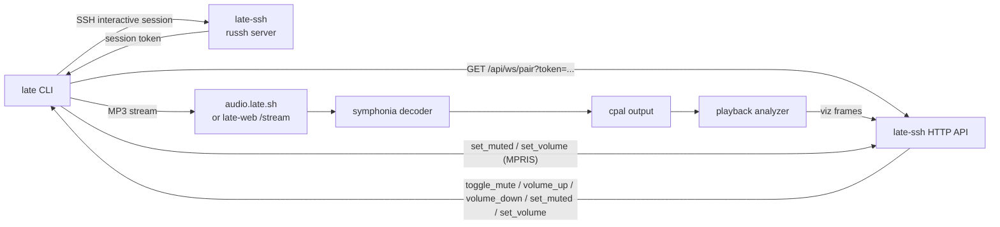

# late-cli Context

## Metadata
- Domain: `late-cli` - companion CLI for late.sh (plus the sibling `late-webview` helper crate)
- Primary audience: LLM agents working on the CLI, human contributors
- Stability note: Sections marked `[STABLE]` should change rarely. Sections marked `[VOLATILE]` are expected to change often.

---

## 0. Context Maintenance Protocol (LLM-First) [STABLE]

This file is the working context for `late-cli`; the root project context is `../CONTEXT.md`. Companion docs here: `DISTRIBUTION.md` (installers, supply chain, update check) and `VIDEO.md` (the News video watch through `mpv`); the YouTube helper is `../late-webview/CONTEXT.md`.

- Update the doc that covers a change in the same change: CLI flags and env vars (`config.rs`), SSH modes, the token handshake, pairing, audio, installers (`scripts/install.*`, `.github/workflows/deploy_cli.yml`).
- Remove a compatibility note when the path it describes is gone.

---

## 1. Summary [STABLE]

`late-cli` builds the `late` companion binary. It launches an SSH TUI session, plays the Icecast MP3 stream locally, analyzes audible samples for the TUI visualizer, pairs with the active SSH session over `/api/ws/pair`, and provides the native LiveKit voice media runtime for late.sh voice rooms.

Primary responsibilities:
- Local SSH launcher for `late.sh`
- Local audio playback via `cpal`
- MP3 stream decoding via `symphonia`
- FFT visualizer frames sent to the SSH TUI over WebSocket
- Paired mute/volume controls received from the TUI
- Linux MPRIS publication for the selected YouTube, Icecast, or radio track
- LiveKit voice capture/playout for native desktop CLI users, controlled over the pair WebSocket
- News watch: plays a shared YouTube link in the terminal through the user's own `mpv` and `yt-dlp`, in a rectangle the TUI reserves
- Cross-platform installer targets for Linux, macOS, Windows, and Android/Termux

Highest-risk areas:
- SSH token handshake compatibility between client and server
- Paired-client WebSocket routing/state drift
- Audio backend/device differences, especially sample-rate fallback and WSL
- LiveKit/WebRTC native audio runtime differences for voice on desktop platforms
- Terminal resize forwarding and pre-token input gating

`late-cli` intentionally has no `late-core` dependency.

---

## 2. Architecture [STABLE]



Runtime flow:
1. Resolve config from built-in defaults, optional config file, env, and CLI args.
2. Resolve/generate SSH identity unless OpenSSH mode is allowed to use normal OpenSSH discovery.
3. Start local audio and analyzer, except OpenSSH mode which authenticates and fetches the token before audio starts.
4. Fetch a session token through the selected SSH transport.
5. Open the real SSH TUI session, except old/native modes where the interactive channel/process is already running with input gated.
6. Connect `/api/ws/pair?token=...` and send visualizer frames plus client state.
7. Apply paired control messages by muting/unmuting or changing local volume.

OpenSSH mode differs slightly: it authenticates and fetches the token first through a ControlMaster, starts audio and WebSocket pairing, then opens the interactive shell through the same master connection.

---

## 3. Entry Points and Files [STABLE]

- `src/main.rs` - top-level orchestration, mode split, audio/WS lifecycle
- `src/clipboard.rs` - paired `/paste-image` clipboard read, Wayland/X clipboard backend use, PNG encoding, and local size guards. Clipboard support is only advertised on Linux, macOS, and Windows; Android/Termux builds do not depend on `arboard`.
- `src/config.rs` - flags, env vars, defaults, logging
- `src/identity.rs` - dedicated key discovery/generation
- `src/latency.rs` - the round trips native mode times for the server (`ssh_rtt`, `terminal`), the sample queue, and the watch that sees the server's terminal probe pass through. See "Latency samples" below
- `src/mpris.rs` - Linux MPRIS service, track metadata projection, and the desktop command queue (transport/volume mapped to server-routed `set_muted`/`set_volume`); other platforms compile a no-op publisher
- `src/ssh.rs` - native SSH, OpenSSH ControlMaster mode, legacy PTY subprocess mode, token parsing, resize forwarding
- `src/pty.rs` - terminal size/PTY helpers
- `src/raw_mode.rs` - local raw-mode guard for modes where CLI owns terminal forwarding, plus `SessionModesGuard`, which turns off mouse reporting and bracketed paste, resets the themed background (OSC 111), and shows the cursor when the session ends in any mode (the server's own teardown never arrives on an idle timeout or a dropped link). It never sends `?1049l`: after a clean exit that would restore a stale cursor over the goodbye line
- `src/ws.rs` - paired-client WebSocket protocol, control handling, client state
- `src/video.rs` - News watch: the `video` capability probe (`blockers`), the `mpv` child (`VideoPlayer`), its JSON IPC socket, the relay that carries mpv's frames to the tty with mpv's terminal-mode writes filtered out (`TtyFilter`), and the kitty-placement cleanup (`settle_sequence`). Pure work that returns `VideoUpdate`s; `ws.rs` sends, logs, and silences the house audio around a play. See `VIDEO.md`
- `src/voice.rs` - LiveKit voice-room media runtime; see `../late-ssh/src/app/voice/CONTEXT.md` for full voice protocol and invariants
- `../late-webview/` - embedded YouTube webview crate (wry/tao/WebKitGTK page host, JS bridge commands, pair-WS relay, `page.html`). Ships as the standalone `late-webview` binary on Linux; compiled into `late` as a library on Windows/macOS. `late-cli` must not depend on it on Linux — that dependency edge is what keeps WebKitGTK out of the `late` binary.
- `src/audio/` - stream probing, decoding, playback queue, resampling, analyzer. `resolve_stream_url` supports Icecast-style base URLs, `/stream/...` paths, and direct `.mp3`/`.m4a`/`.aac` URLs. Pair-WS `set_playback_source` can retarget native audio to a server-provided `stream_url`; `src/ws.rs` keeps a hardcoded Chillsynth URL only as a legacy radio fallback when an old server omits `stream_url`.
- `Cargo.toml` - crate metadata; `otel` feature currently exists but is empty and default features are empty
- `README.md` - user-facing CLI docs
- `../scripts/install.sh` and `../scripts/install.ps1` - public installers
- `../scripts/run_local_cli*.sh`, `../scripts/run_prod_cli*.sh`, and PowerShell variants - repo helper launchers
- `../.github/workflows/deploy_cli.yml` - release artifact build/publish workflow

---

## 4. Config and Env Vars [STABLE]

Config resolution order is built-in defaults, then the optional config file, then env vars, then explicit CLI args.

The config file path defaults to `$XDG_CONFIG_HOME/late/config.toml` or `~/.config/late/config.toml`; `--config <path>` overrides it. Missing default config files are ignored. Missing explicit config files and parse errors print a warning and continue with lower-precedence values. Supported config-file keys are flat TOML keys matching the main CLI flags: `ssh-target`, `ssh-port`, `ssh-user`, `ssh-mode`, `key`, `audio-base-url`, `api-base-url`, `audio-output-device`, and `verbose`. TUI keybinds, themes, room/sidebar settings, and other in-app preferences are server-side user settings and do not belong in the CLI config file.

Defaults in `src/config.rs`:
- `--config <path>`: optional config file override; no env var
- `--ssh-target` / `LATE_SSH_TARGET`: default `late.sh`
- `--ssh-port` / `LATE_SSH_PORT`: optional
- `--ssh-user` / `LATE_SSH_USER`: optional
- `--key`, `--identity-file` / `LATE_KEY_FILE` / legacy `LATE_IDENTITY_FILE`: optional identity override
- `--ssh-mode` / `LATE_SSH_MODE`: `native` default; also `openssh` or `old`
- `--ssh-bin` / `LATE_SSH_BIN`: default `ssh`; parsed with shell-like quoting for OpenSSH/old modes
- `--audio-base-url` / `LATE_AUDIO_BASE_URL`: default `https://late.sh`; this is a legacy fallback/proxy URL. Current servers send authoritative native stream URLs over pair-WS `set_playback_source`.
- `--audio-output-device` / `LATE_AUDIO_OUTPUT_DEVICE`: optional exact CPAL output device name. When unset, the CLI uses the system default output device.
- `--api-base-url` / `LATE_API_BASE_URL`: default `https://api.late.sh`
- `LATE_LOG_FILE`: optional parent CLI tracing log path override. Default is `$XDG_STATE_HOME/late/late.log`, `~/.local/state/late/late.log`, or platform temp fallback.
- `LATE_LOG_STDERR=1`: force parent CLI tracing to stderr. Without this, an interactive `late --verbose` writes tracing to the log file so logs do not corrupt the SSH TUI. If stderr is already redirected, tracing writes to stderr for compatibility with `late -v 2>late-debug.log`.
- `LATE_WEBVIEW_BIN`: optional explicit path to the `late-webview` helper binary (Linux and other non-Windows/macOS platforms). Default resolution is a `late-webview` sibling of the `late` executable, then `$PATH`.
- `LATE_WEBVIEW_LOG`: optional embedded YouTube helper stderr log path override. Default is `$XDG_STATE_HOME/late/webview.log`, `~/.local/state/late/webview.log`, or platform temp fallback.
- `LATE_WEBVIEW_DEBUG_STDERR=1`: inherit the embedded YouTube helper's stderr instead of redirecting it to the helper log file. Useful with `late -v 2>late-debug.log` when diagnosing GTK/WebKit/GStreamer startup.
- The parent starts the embedded YouTube helper with `NO_AT_BRIDGE=1` to opt the helper out of the AT-SPI accessibility bridge. This avoids host `libatk-bridge-2.0` crashes caused by stale `at-spi-bus-launcher`/dbus state while keeping the setting scoped to the helper process. On Linux it also sets `WEBKIT_DISABLE_DMABUF_RENDERER=1` by default if the caller did not set that variable, matching the common Arch/Wayland workaround for WebKitGTK DMABUF renderer failures.
- `LATE_MPV_BIN`: optional explicit `mpv` for News watch; default is `mpv` on `$PATH`.
- `LATE_YTDLP_BIN`: optional explicit `yt-dlp`; passed to mpv as `--script-opts=ytdl_hook-ytdl_path=...`. Default lets mpv's ytdl hook find `yt-dlp` on `$PATH`.
- `LATE_VIDEO_SHM`: `yes` or `no` forces shared-memory video frames on or off (`video::use_shared_memory`); anything else leaves the per-terminal table (kitty and Ghostty on, the rest off). For trying the other path on a terminal that tears or one the table is wrong about.
- `LATE_VIDEO_LOG`: optional mpv stderr log path override. Default is `$XDG_STATE_HOME/late/video.log`, `~/.local/state/late/video.log`, or platform temp fallback (same resolution as the webview log).
- `-v`, `--verbose`: enables debug logging when `RUST_LOG` is not set
- `LATE_NO_UPDATE_CHECK=1`: skips the pre-connect "update available" check (see `DISTRIBUTION.md`, Update check). Any non-empty value other than `0` disables it.
- `LATE_INSTALL_BASE_URL`: distribution host override shared with the installer; the update check fetches `{base}/VERSION` from it (default `https://cli.late.sh`).

Logging:
- Without `RUST_LOG` and without `--verbose`, tracing output is disabled.
- With `--verbose` and no `RUST_LOG`, the filter is `warn,symphonia=error,late=debug`.
- If `RUST_LOG` is set, it wins through `tracing_subscriber::EnvFilter`.
- In an interactive terminal, enabled tracing goes to `LATE_LOG_FILE`/the default CLI log path and startup prints that path once before the TUI takes over. Set `LATE_LOG_STDERR=1` for old stderr behavior.
- `main()` installs Rustls' `ring` crypto provider before any config, HTTP, WebSocket, or LiveKit setup. This is required because the CLI dependency graph can contain both Rustls providers (`aws-lc-rs` from `reqwest` defaults and `ring` from LiveKit/WebSocket TLS), and Rustls panics if no process-level provider is selected explicitly.

Local helper scripts use local override env vars:
- `LATE_LOCAL_SSH_PORT`, falling back to `.env` `LATE_SSH_PORT` or `2222`
- `LATE_LOCAL_API_BASE_URL`, default `http://localhost:${LATE_API_PORT:-4000}`
- `LATE_LOCAL_AUDIO_BASE_URL`, default `http://localhost:${LATE_WEB_PORT:-3000}/stream`
- `LATE_LOCAL_SSH_TARGET`, default `localhost`
- `LATE_LOCAL_SSH_USER`, optional

Prod helper scripts use:
- `LATE_PROD_SSH_TARGET`, default `late.sh`
- `LATE_PROD_API_BASE_URL`, default `https://api.late.sh`
- `LATE_PROD_AUDIO_BASE_URL`, default `https://audio.late.sh`
- `LATE_PROD_SSH_PORT`, optional
- `LATE_PROD_SSH_USER`, optional

---

## 5. SSH Modes, Identity, and Token Handshake [STABLE]

### Native mode

`--ssh-mode native` is the default. It uses embedded `russh`, does not require `ssh` on `PATH`, verifies server keys against `~/.ssh/known_hosts`, and learns first-seen keys with accept-new semantics.

Native mode uses a dedicated SSH exec request:

```text
late-cli-token-v1
```

The server must return JSON:

```json
{ "session_token": "..." }
```

After the token is received, native mode opens the interactive SSH channel. There is no fallback to the legacy `LATE_SESSION_TOKEN=` banner protocol.

Native target parsing supports `user@host:port` and bracketed IPv6. If no user is supplied, it falls back to `USER`, then `USERNAME`, then `late`.

### OpenSSH mode

`--ssh-mode openssh` is for OpenSSH-managed auth flows, especially YubiKey/FIDO identities. It is Unix-only.

Behavior:
- Starts a private OpenSSH ControlMaster with `StrictHostKeyChecking=accept-new`
- Allows OpenSSH to own terminal prompts for PIN/passphrase/touch/agent/config handling
- Fetches the token with `late-cli-token-v1` over the control socket using `BatchMode=yes`
- Opens the interactive shell through the same control socket with `BatchMode=yes -tt`
- Cleans up the control socket directory on close/drop

If no explicit key is supplied, OpenSSH mode lets OpenSSH use normal `~/.ssh/config`, agent, and default identity discovery.

### Old subprocess mode

`--ssh-mode old` keeps the legacy OpenSSH-through-PTY path. It starts a system `ssh` client, sends `LATE_CLI_MODE=1`, and intercepts this one-line banner from the PTY stream:

```text
LATE_SESSION_TOKEN=<base64url-uuid-v7>
```

This mode remains a compatibility fallback.

Server tokens are compact URL-safe base64 UUIDv7 strings. Current tokens are 22 characters.

### Identity rules

- Default dedicated key path: `~/.ssh/id_late_sh_ed25519`
- `--key` / `LATE_KEY_FILE` override the path
- `LATE_IDENTITY_FILE` remains a legacy env fallback
- If the selected key path does not exist and stdin/stdout are interactive, the CLI offers to generate an Ed25519 key natively
- If the selected key path does not exist in a non-interactive terminal, the CLI fails with an explicit message
- Native SSH key-load and public-key authentication failures append a generic key setup hint with `ssh-keygen -t ed25519 -f <path> -C late.sh` plus `late --key <path>`. Keep this generic to avoid username/fingerprint enumeration.
- Native mode suppresses the server's generic pre-auth public-key setup banner; the CLI owns more precise local key generation and auth-failure hints. OpenSSH/old modes use system OpenSSH paths and may display server auth banners directly.
- On Unix, generated directories/files are chmod'd toward `0700` and `0600`
- Home lookup order is `HOME`, then `USERPROFILE`, then `HOMEDRIVE` + `HOMEPATH`

### Input gating invariant

In modes where the CLI owns input forwarding (`native` and `old`), stdin must stay blocked until the token phase completes. Keys typed during handshake/welcome race windows are intentionally discarded, then pending terminal input is flushed immediately before forwarding starts.

OpenSSH mode is the exception because system OpenSSH owns terminal input during auth and opens the interactive shell only after token acquisition.

---

## 6. Pairing Protocol [STABLE]

`late-cli` pairs to the active SSH session with:

```text
GET /api/ws/pair?token={token}
```

`--api-base-url` may be `http://`, `https://`, `ws://`, or `wss://`; `src/ws.rs` rewrites HTTP schemes to WebSocket schemes.

Client to server:

```json
{ "event": "heartbeat", "position_ms": 1234 }
```

```json
{ "event": "viz", "position_ms": 1234, "bands": [0.0, 0.0, 0.0, 0.0, 0.0, 0.0, 0.0, 0.0], "rms": 0.0 }
```

```json
{
  "event": "client_state",
  "client_kind": "cli",
  "ssh_mode": "native",
  "platform": "linux",
  "capabilities": ["clipboard_image", "youtube", "voice", "open_url"],
  "video_blockers": ["not_kitty", "no_mpv"],
  "muted": false,
  "volume_percent": 30
}
```

Client to server, from the Linux desktop MPRIS surface (widget play/pause, media keys, volume slider). The server fans the matching `set_muted`/`set_volume` control back to every paired client on the token:

```json
{ "event": "set_muted", "muted": true }
{ "event": "set_volume", "volume_percent": 45 }
```

Server to client:

```json
{ "event": "toggle_mute" }
```

```json
{ "event": "volume_up" }
```

```json
{ "event": "volume_down" }
```

```json
{ "event": "set_muted", "muted": true }
{ "event": "set_volume", "volume_percent": 45 }
```

```json
{ "event": "request_clipboard_image" }
```

```json
{ "event": "set_playback_source", "source": "icecast|youtube|radio", "stream_url": "...", "station": "..." }
```

```json
{ "event": "voice_join", "room": "late-voice-00000000-0000-0000-0000-000000000000", "url": "wss://rtc.late.sh", "token": "...", "muted": true, "deafened": false }
{ "event": "voice_leave" }
{ "event": "voice_set_muted", "muted": true }
{ "event": "voice_set_deafened", "deafened": true }
```

Client to server, in response to `request_clipboard_image`:

```json
{ "event": "clipboard_image", "data_base64": "<base64 png bytes>" }
```

```json
{ "event": "clipboard_image_failed", "message": "clipboard does not contain an image" }
```

Client to server for voice state:

```json
{ "event": "voice_state", "joined": true, "room": "late-voice-00000000-0000-0000-0000-000000000000", "muted": false, "deafened": false, "speaking": false }
```

Client to server, native mode only (see "Latency samples"):

```json
{ "event": "latency", "kind": "ssh_rtt", "micros": 42000 }
{ "event": "latency", "kind": "terminal", "micros": 900 }
```

Client state labels:
- `ssh_mode`: `native`, `openssh`, `old`
- `platform`: `linux`, `macos`, `windows`, `android`, or `unknown`
- `capabilities`: optional list; Linux, macOS, and Windows desktop CLI builds advertise `clipboard_image`, `youtube`, `voice`, and `open_url`; Android/Termux builds leave the base list empty. `video` is appended on any build whose startup probe finds no blocker (see "Video watch" below).
- `video_blockers`: present exactly when `video` is not in `capabilities`; every failing precondition by wire name: `not_native`, `platform`, `multiplexer`, `not_kitty`, `no_pixel_size`, `no_mpv`, `mpv_too_old`, `no_ytdlp`.

Pairing behavior:
- The server stores one paired-client sender/state entry per token.
- If the CLI and its webview helper both pair on the same token, latest registration owns control/state until it disconnects.
- CLI WebSocket reconnects with a 2s delay for 10 consecutive failures, then keeps reconnecting every 60s. Pairing is never abandoned, so a server redeploy or a network change cannot leave a live SSH session permanently unpaired. A connection that held for 60s (`STABLE_CONNECTION`) clears the failure count, so one long session's worth of rare drops never accumulates into a give-up. Policy lives in `ws.rs`'s `PairRetryPolicy` (pure, tested in `ws_test.rs`); `main.rs`'s pair loop owns the sleeping, logging, and mute write.
- The pair WebSocket loop is selected alongside SSH session completion in the root async task, not spawned with `tokio::spawn`. This is intentional because native LiveKit voice room state is not guaranteed to be `Send` across desktop platforms.
- The first `client_state` is sent immediately after connect. It is resent after local mute/volume controls; source changes, voice, and video use their own handling (`voice_state`, `video_state`). The video probe runs once at startup, so a fixed setup is picked up on the next `late` launch.
- `/paste-image` in SSH chat depends on the paired CLI control channel. The server only sends `request_clipboard_image` after seeing `clipboard_image` in the latest paired client's `client_state.capabilities`, so older CLIs and the webview helper do not receive unsupported control events.
- Linux Wayland support for `/paste-image` depends on the workspace `arboard` dependency enabling `wayland-data-control`; Hyprland uses this path. Without it, the CLI may report that the clipboard does not contain an image even when Wayland has `image/png` content.
- Latency samples: the server times the whole trip to the user's terminal by following frames with a DSR status query (`CSI 5 n`) and waiting for `CSI 0 n` (`late-ssh/src/terminal_probe.rs`). The CLI passes both through untouched and splits the trip. `ssh_rtt` times `send_ping` (an SSH keepalive and its reply) every 10 s, the transport alone; `terminal` runs from the output loop reading the chunk that carries the query to the stdin thread reading the answer, the user's terminal alone, including any frame still being parsed ahead of it (`TerminalProbeWatch`). Both go into a 16-sample queue (`latency_queue`) that the pair loop drains as `latency` events; a full queue (socket down) drops samples rather than waiting. Native mode only: `openssh` gives the terminal to an ssh child outright, and `old` (which relays it through a local pty) is not wired, so their queue stays empty. The server records them as `late_ssh_cli_latency_seconds{kind,platform}`, and a server older than the CLI logs a parse error per sample, so it must deploy first.
- Clipboard images are converted to PNG in the CLI before upload. The CLI rejects zero-size images, very large decoded RGBA buffers, and PNG payloads above the upload cap before sending them over the pair socket.

Embedded YouTube helper window:
- The helper opens a minimal 200x200 non-resizable, undecorated webview window while the user source is YouTube. On Linux the helper is the standalone `late-webview` binary installed next to `late` (`LATE_WEBVIEW_BIN` overrides, `$PATH` is the last fallback); on Windows/macOS it is `late webview-pair`, the `late` binary re-executed with the webview compiled in. `late webview-pair`/`late webview-spike` on Linux just forward to the external binary.
- Linux invariant: `late` itself must never link WebKitGTK/GTK. A machine without the webview libraries has to run the full CLI; only embedded YouTube playback may degrade. Missing helper binary or missing WebKitGTK/GStreamer libraries fail the helper spawn/startup and land in the crash-loop backoff below — installing the distro packages later fixes playback with no CLI reinstall. The helper page gives the YouTube iframe the full viewport, disables YouTube's visible controls, and does not draw app UI over the player.
- The helper page is served from a loopback listener but loaded as `http://localhost:<port>/`, sends `Referrer-Policy: strict-origin-when-cross-origin`, and passes `window.location.origin` as the YouTube IFrame `origin`.
- By default the parent redirects helper stderr to the webview log path. For a single combined debug capture, run `LATE_WEBVIEW_DEBUG_STDERR=1 late -v 2>late-debug.log`; this captures both parent CLI tracing and helper GTK/WebKit/GStreamer output.
- The normal helper spawn sets `NO_AT_BRIDGE=1` and, on Linux, sets `WEBKIT_DISABLE_DMABUF_RENDERER=1` unless the user already set it. If `late webview-spike ...` is run directly during debugging and crashes in `libatk-bridge-2.0.so` after `dbind-WARNING`, retry as `NO_AT_BRIDGE=1 late webview-spike <video_id>` or restart stale `at-spi-bus-launcher` processes.
- The helper's pair WebSocket reconnects on drops (2s delay, up to 10 consecutive failures, counter reset once a connection has lived 60s) instead of exiting the process, so server redeploys and network blips do not tear down the window or reset mute/volume. The helper process exits only on window close, a real crash, or a reconnect give-up.
- While the source is YouTube, the parent checks the helper child from the pair-WS 1s heartbeat (`maintain_helper`) and respawns it if it died, honoring the crash backoff below. Respawn must not depend on `set_playback_source` replays: the server can miss the helper's disconnect entirely on a half-open TCP drop and then never replays.
- At spawn the parent passes its current mute/volume via `LATE_WEBVIEW_INITIAL_MUTED` / `LATE_WEBVIEW_INITIAL_VOLUME` (internal parent-to-helper env, not user config); the helper seeds its audio settings from them and pushes them into the page on the page's `ready` event. Server-side, `api.rs` aligns a connecting webview client's mute to the live CLI entry's muted state instead of `start_with_music_muted`, so a respawned or reconnected helper keeps the session's runtime mute.
- If the embedded helper exits or fails to start 3 times within 60 seconds, the parent disables embedded YouTube fallback for 5 minutes and logs the helper log path. This prevents the repeated open/close loop when a host WebKit/GStreamer install is broken. Nothing takes over: YouTube is simply unavailable in the CLI until the helper works, and users can listen at late.sh/listen meanwhile. After the backoff expires the heartbeat watchdog retries automatically.
- The helper requests no initial focus, always-on-bottom placement, and an initial top-right position on the primary monitor; on Linux it also skips the taskbar. These are best-effort window-manager hints, not a hidden/background player. On Linux/Wayland the app id/class is `sh.late.youtube`; Hyprland may ignore always-on-bottom or client-side positioning, so users who need stronger routing should use a special workspace/scratchpad instead of relying on fully off-screen placement.
- On Linux the spawn also sets `PULSE_PROP` and `PIPEWIRE_PROPS` (`application.id=sh.late.youtube`, `late.webview.owner=<late pid>`), so the helper's WebKit audio streams can be found and recorded for the equalizer. The capture (`src/audio/loopback.rs`) lives in `RunningHelper` beside the helper child and stops with it. See §7 and `late-webview/CONTEXT.md`, "YouTube spectrum".
- On initial helper open only, `webview-pair` uses the first `queue_update.current.started_at_ms` snapshot to apply one `startSeconds` value to the first matching `load_video`. If a `load_video` arrives before that first snapshot, the relay buffers it and flushes it when the snapshot decision is known. After that first load is dispatched, heartbeats and later track switches do not receive a seek offset and continue through the normal `loadVideoById({ videoId })` path.
- The helper page suppresses transient YouTube IFrame `unstarted`/`cued` states and only reports `ended` after the current item has reached `playing`; the server still owns queue advancement through its playback timer.
- If YouTube rejects the embedded iframe with `101`, `150`, or `153`, the helper logs the rejection and stays on its controlled bridge page. It does not navigate to the normal `youtube.com/watch` page because that would leave the local player bridge and make source switching/state harder to reason about.

### Video watch

In `VIDEO.md`: the `video` capability, the server-to-client placement and control messages, and the `mpv` child (`src/video.rs`).

## 7. Audio Runtime [STABLE]

`late-cli` opens the audio stream once and uses one decoded path for both playback and visualization.

Audio path:
1. Probe the MP3 stream with `SymphoniaStreamDecoder`.
2. Choose the output sample rate from the configured `cpal` output device, or the system default when no device name is configured.
3. Prefer the stream's native `44.1 kHz` when supported.
4. If the device requires another rate, such as `48 kHz`, resample locally with streaming linear resampling.
5. Decode frames into a lock-free SPSC playback ring buffer.
6. The output callback applies mute/volume and pushes post-volume mono samples into the played ring, but only while output is audible (not muted, native source selected).
7. The analyzer thread (`src/audio/analyzer.rs`) reads the played ring and, on each tick that played new samples, broadcasts `VizSample { bands: [f32; 16], rms }`. Each pair session subscribes fresh and sends frames as `viz` events.
8. YouTube on Linux: while the helper runs, `src/audio/loopback.rs` records the helper's tagged PipeWire stream with `pw-record` (already post-volume, since the page applies mute and volume), and feeds a ring into a second `spawn_playback_analyzer_thread` on the same `analyzer_tx`. The native output is silent while YouTube is selected, so the two analyzers never interleave frames.

Critical audio invariant:
- The analyzer must follow audible output, not raw decoded samples. Lowering volume shrinks the bars. Silence sends nothing at all: a muted CLI, a YouTube-selected CLI with no helper capture, or an underrun produces no frames, so the TUI's spectrum goes stale and falls back on its own (muted shows the flat line, an uncaptured YouTube the ambient band). Never push zeros for silence; a stream of empty frames would pin the TUI on flat live bars. The helper capture holds the same line by dropping chunks of exact digital zero.
- A silenced CLI holds no stream connection. While the user is muted, or the selected source is one the CLI cannot play natively (YouTube), the decoder thread (`src/audio/decoder_thread.rs`) drops its HTTP stream and parks, polling every 50ms; an open stream downloads at full bitrate (up to 320 kbps on Nightride) whether or not anyone hears it. When output becomes audible again it reconnects to the current URL, so unmute costs one connect before sound returns. A station change made while parked is only recorded and connected on resume. Startup is exempt until the decoder has reported ready and `BOOT_GRACE` (10s) has passed: the CLI boots muted as a placeholder and the server sends nothing when that already matches the stored state, so parking on it would close the stream startup just opened and drain the WSL prebuffer moments before the first unmute. A user who really is muted, or on YouTube, streams for those 10s and then parks. `decoder_thread_test.rs` pins the mute case, the source case and the boot placeholder against a local fake stream.
- The CPAL output callback must not take a mutex or allocate per output frame. Keep decoder-to-output transport on a lock-free SPSC ring and map channels directly into the callback buffer.
- Reuse Symphonia `SampleBuffer` storage across decoded packets; do not allocate a fresh conversion buffer per packet.

Platform notes:
- Android/Termux currently disables local audio in the runtime and still allows the SSH/client path to proceed.
- WSL uses a dedicated audio profile: fixed 2048-frame CPAL buffer where possible, a short prebuffer before `stream.play()`, and fail-open startup. If local WSL audio cannot start, the CLI continues into SSH with audio disabled and points users to late.sh/listen or Windows-native `late.exe`.
- On all platforms, local audio startup failure now fails open: the CLI continues into SSH/pairing with audio disabled.
- WSL startup failures include a targeted hint that checks `DISPLAY`, `WAYLAND_DISPLAY`, and `PULSE_SERVER`.
- A working configured or default local audio output device is required for full desktop CLI audio, but not for SSH connection.
- MP3 is the only enabled stream format.
- Stream URL normalization trims trailing slashes, preserves `/stream`, `/stream/...`, and direct `.mp3`/`.m4a`/`.aac` URLs, and appends `/stream` only for base URLs.
- Stream probing scans up to 64 KiB for MP3 sync/ID3 before probing.
- Initial volume is 30%. Enabled desktop audio boots muted until the pair WebSocket delivers the user's initial mute/source state; if the server never sees this session at all, the CLI releases that startup mute once, after 10 failed attempts, rather than leave the user silently muted with no explanation. Volume uses squared scaling.
- Releasing the startup mute is gated on the session never having paired, and that gate is load-bearing: a session the server has already seen is running the user's stored device mute, so a mid-session pair-WS outage must leave the mute alone. Silence is the safe failure mode; unmuting on reconnect failure would start music behind the user's back in a muted session. The fact is structural, not guessed: `run_pair_session` reports whether any frame arrived from the server (`PairSessionEnd::server_frame_received`), and only such a session counts as `PairAttempt::Ended`. A successful `client_state` write is not enough, because the server accepts the WebSocket upgrade before it checks the per-IP pair limit and the per-token capacity, so a rejected socket still takes the write and then dies unread; the server's first frame (`set_playback_source`, sent right after registering) is what proves the session was registered and the buffered `client_state` read. Because the slow retry never gives up, a session that did release the mute still gets the stored value applied when the server comes back, since the server's alignment is claimed once per session token and was never claimed.
- On Linux, the pair client consumes `queue_update`, `now_playing_update`, and `radio_meta_update` snapshots and publishes the currently selected source through `org.mpris.MediaPlayer2`. YouTube includes title/channel/duration, watch URL, thumbnail, and wall-clock-derived initial position; Icecast and radio select the metadata entry matching `set_playback_source.station`. The house mounts arrive as radio stations: their title and artist come from `radio_meta_update` (the server merges them in), their track length from `now_playing_update`. Missing metadata falls back to the source/station label, with no artist.
- MPRIS is controllable, but only over mute and volume. `Play`/`Pause`/`PlayPause`/`Stop` resolve through `TransportCommand` to an absolute mute target, and `SetVolume` maps the slider to a percent (raising it off zero also unmutes). `CanPlay`/`CanPause`/`CanControl` are therefore true, `CanSeek`/`CanGoNext`/`CanGoPrevious` false. Muted publishes as `Paused` rather than a zeroed volume, which is what a desktop widget draws a play button for. Reporting the read-only truth (`CanControl=false`) is spec-correct but makes the player invisible to **playerctl**, which skips any player whose `can-play` is false, and with it waybar/polybar, since those link `libplayerctl`.
- Desktop writes are not applied locally. The MPRIS interface queues a `DesktopCommand`, the pair WS loop sends it as a `set_muted`/`set_volume` event, and the server fans the result back to every paired client (`PairControlMessage::SetMuted`/`SetVolume`), exactly like a TUI `m` keypress. That round trip is what lets a widget pause reach YouTube, which plays in the separate `late-webview` helper on its own pair WS, and it keeps CLI, helper, and sidebar convergent. It also means controls need a live pair socket, and the widget updates when the fan-out lands rather than instantly.
- MPRIS startup and update errors fail open. Headless Linux, WSL, containers, and other environments without a usable session D-Bus continue SSH/audio normally without desktop publication.
- The playback queue caps at roughly two seconds of output samples.
- Analyzer cadence is about 15 Hz with a 2048-sample FFT and 16 log-spaced bands (60 Hz to 12 kHz; `VIZ_BANDS` in `src/audio/mod.rs` matches `late_core::audio::VIZ_BANDS`). A bin belongs to the band its center frequency falls in, so a tone lights one band. Each band's mean FFT magnitude, scaled back to the 1024-sample window the constants were fitted on, maps to meter height on a dB scale: floor -18 dB, 60 dB span, plus 2 dB of tilt per band (30 dB bottom to top) so the treble registers; RMS maps -48..0 dBFS. The constants were fitted on captured Icecast, Nightride synthwave, and house streams to sit near half height at 70% volume with room above for hits.

Audio and stream resiliency:
- WebSocket pairing retries every 2s for 10 consecutive failures, then every 60s for as long as the session lives; see §6 for the stable-connection reset and the mute rule.
- Startup stream probing and the decoder thread's first stream open each retry 3 times with a short 750ms delay before aborting startup. This covers rare Icecast/network timing blips where the first CLI launch says "failed to create audio decoder" but immediately joining again works.
- Decoder recovery re-probes `SymphoniaStreamDecoder` in place after stream failures, sleeps 2s between reconnects, and gives up after 10 consecutive failures.
- CPAL output stream errors are printed to stderr by the stream's error callback; nothing is reported to the server.
- `viz` frames drive the TUI equalizer's live spectrum for Icecast and radio, and on Linux for YouTube through the helper capture (see `late-ssh/src/app/audio/VIZ.md` and `late-webview/CONTEXT.md`). An older CLI without the analyzer sends none and keeps the ambient band.
- The helper capture fails open. Missing `pw-dump` or `pw-record` logs one warning and YouTube keeps the ambient band; a failing graph read warns once per run of failures and retries every second; a recorder whose stream vanished is dropped and the next matching stream is picked up; a recorder that exits while its stream is still listed warns once with its exit status and respawns every second until one holds.

---

## 8. Terminal and Resize Handling [STABLE]

Resize behavior:
- Native mode sends SSH `window-change` requests over the `russh` channel.
- Old mode resizes the local PTY attached to the system `ssh` process.
- OpenSSH mode delegates resize handling to the system `ssh` client.
- On Unix, resize forwarding follows `SIGWINCH`.
- On non-Unix native mode, resize forwarding polls terminal size changes every 250ms.
- Default terminal size fallback is `80x24`.

The CLI binary must forward local terminal resizes so side-by-side panes and split windows reflow after startup.

News watch reads the tty's pixel size (`TIOCGWINSZ` `ws_xpixel`/`ws_ypixel` on stdout) at startup and again at every mpv spawn; a terminal that reports zero cannot host a video. The TUI, not the CLI, decides the video rectangle: a resize reaches the CLI as a `video_place` from the server, never from the CLI's own `SIGWINCH`.

Raw mode:
- Native and old modes enable CLI raw mode.
- OpenSSH mode leaves raw mode to system OpenSSH so auth prompts retain normal terminal behavior.
- On Windows native mode, the CLI must enable virtual-terminal/ANSI output before forwarding remote SSH bytes and virtual-terminal input before forwarding local stdin bytes. The server sends alt-screen, mouse, bracketed-paste, OSC, color, and cursor sequences as raw bytes; PowerShell/conhost sessions can print literal `ESC[` text unless `late.exe` flips the console output mode first. Arrow keys, Esc-prefixed keys, and similar special keys can fail to reach the remote TUI unless `late.exe` also enables VT input on the console input handle.
- Native mode forwards terminal capability env hints (`TERM_PROGRAM`, `LC_TERMINAL`, `TERM_FEATURES`, Kitty/WezTerm/Ghostty/Konsole vars, and Windows Terminal `WT_SESSION`/`WT_PROFILE_ID`) after PTY setup and before shell startup. `late-ssh` uses these hints to choose Kitty/iTerm2/Sixel image protocols when `TERM` alone is generic, which is especially important for Windows Terminal running PowerShell.

Shutdown invariant:
- Native mode treats SSH channel `EOF` the same as `Close` for interactive-session shutdown.
- Native and old modes must not run stdin forwarding in Tokio `spawn_blocking`: a thread blocked in `stdin.read()` cannot be aborted and can keep the runtime alive after the server has printed the farewell frame. Use a detached OS thread for stdin forwarding so process exit is controlled by the SSH completion task, not by the next local keypress.

---

## 9. Distribution [VOLATILE]

In `DISTRIBUTION.md`: the public installers and their overrides, the supply chain (checksums, Sigstore attestations, the release workflow), and the update check (`src/update.rs`).

---

## 10. Testing and Command Policy [STABLE]

Inline unit tests in `late-cli/src/` should stay pure logic only:
- Config parsing and defaults
- SSH mode parsing
- `--ssh-bin` parsing
- WS URL construction
- WS control-message effects on mute/volume
- Playback position math
- Home directory and identity path logic
- Resampler/analyzer math where deterministic
- Token response parsing and command-spec construction

Do not put integration-flavored tests inside `#[cfg(test)]` modules if they require live SSH, WebSocket, audio devices, network, or async service orchestration.

LLM command policy from root context applies here:
- Agents run the tests targeted at their change only through `make test-llm ARGS="-p late-cli -E 'test(<filter>)'"`, never raw `cargo test`/`cargo nextest`, and never `cargo clippy`.
- Full suites and `make check` stay with the human owner.
- `mix format` is irrelevant here; for Rust formatting, mention `cargo fmt --all -- --check` when handing off.

---

## 11. Runbook and Debugging [STABLE]

Common local commands:

```bash
scripts/run_local_cli_native.sh
scripts/run_local_cli.sh
scripts/run_prod_cli_native.sh
scripts/run_prod_cli.sh
```

Local end-to-end pairing needs:
- `late-ssh` API reachable, usually `localhost:4000`
- `late-ssh` SSH reachable, usually `localhost:2222`
- `late-web` stream proxy reachable, usually `localhost:3000/stream`
- Icecast/Liquidsoap stack serving `/stream`
- A usable configured or default audio output device unless running on Android

Troubleshooting:
- SSH will not connect: check `--ssh-target`, `--ssh-port`, selected SSH mode, key path, known-host trust, and whether `ssh late.sh` works directly.
- Native/OpenSSH token failure: verify the server supports `late-cli-token-v1`; native and OpenSSH modes intentionally do not fall back to the legacy banner.
- Old mode token failure: verify the server emits `LATE_SESSION_TOKEN=...` when `LATE_CLI_MODE=1` is sent.
- No audio: check local output device, `--audio-output-device` / `LATE_AUDIO_OUTPUT_DEVICE`, stream URL, Icecast/Liquidsoap health, and WSL audio env (`DISPLAY`, `WAYLAND_DISPLAY`, `PULSE_SERVER`).
- Visualizer not updating: check token match, `/api/ws/pair` reachability, WebSocket scheme rewriting, and whether analyzer frames are being produced from post-output samples.
- TUI volume keys do nothing: ensure the CLI is the latest paired client for that session token and is sending `client_state`.

Relevant TUI controls:
- `m`: toggle mute on paired client
- `+` / `=`: volume up on paired client
- `-` / `_`: volume down on paired client
- `P`: Home combined install modal, with curl, Nix, build-from-source options and the late.sh/listen QR/link

---

## 12. Current Known Gaps [VOLATILE]

- Full desktop CLI audio still depends on a working configured or default local audio output device; without one, the CLI proceeds into SSH/pairing with local audio disabled.
- Embedded YouTube on Linux depends on the `late-webview` helper binary being installed next to `late` (plus the host WebKitGTK/GStreamer packages). A missing helper or missing libraries only disables embedded YouTube via the crash backoff; radio and icecast are unaffected, and the queue stays listenable at late.sh/listen. Linux users must install `webkit2gtk-4.1 gst-plugins-good gst-libav` for YouTube; the decided replacement chain is in `devdocs/PLAN-CLI-YOUTUBE-BACKEND.md`.
- Darwin Nix builds (`nix build .#late` on macOS) are wired but unverified: the WebRTC archives and `xcrun` provider are declared, and nobody has run the build on a mac yet.
- OpenSSH mode is Unix-only; Windows users should use native mode.
- Old mode remains as a compatibility path and still depends on system OpenSSH plus PTY behavior.
- Native mode does not handle OpenSSH/FIDO/YubiKey auth flows; users must switch to OpenSSH mode for those.
- `scripts/run_local_cli.sh` checks for `script` but does not use it.
- News watch cannot run on Windows (no Kitty graphics in Windows Terminal, console path untested), inside tmux or screen, in OpenSSH or old mode, or in a non-Kitty terminal (Sixel is too slow for video, iTerm2's protocol has no shared memory). The probe runs only at startup, so installing `mpv`/`yt-dlp` takes a `late` restart.
- News watch cannot tell a `yt-dlp` failure from any other mpv failure: both arrive as an mpv exit status. `--terminal=no` leaves mpv's stderr silent, so mpv writes its own `--log-file` (`video.log`, truncated per play) and the CLI puts that file's last `[e]`/`[f]` line into `video_state.message` (`mpv_log_reason`), which the server logs and never shows.
